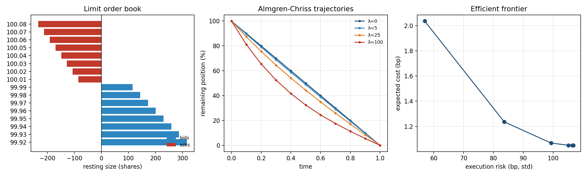

# Kairos Microstructure · 市场微观结构与最优执行

[](https://github.com/Bruce848647703/kairos-microstructure/actions/workflows/ci.yml)

> **从订单簿到执行成本**：限价订单簿（FIFO 队列）→ 走簿成本 → 平方根 / Kyle 冲击 →
> Almgren-Chriss 最优轨迹 → 有效前沿 → 从成交数据还原 Roll 价差与 Kyle λ。

零第三方依赖（`numpy` + 标准库），39 个测试 + GitHub Actions CI，固定种子可复现。

---

## 1. 为什么需要它

`kairos-execution` 有 OMS、TWAP/VWAP 和 TCA，但**没有订单簿，也没有冲击模型**。没有它们，
「这笔单子会亏多少执行成本」只能拍脑袋。这个库补上三件事：

1. **订单簿真的会被吃掉**：市价单逐档撮合，冲击是算出来的，不是假设的；
2. **冲击有模型**：平方根经验律、Kyle 线性冲击、Almgren-Chriss 的临时/永久分解；
3. **执行有计划**：给定风险厌恶，AC 给出「每笔卖多少」的闭式解，并画出成本-风险前沿。



（左：订单簿深度；中：不同风险厌恶下的 AC 轨迹；右：成本-风险有效前沿。）

## 2. 快速开始

```bash
git clone https://github.com/Bruce848647703/kairos-microstructure && cd kairos-microstructure
python -m pip install -e ".[dev]"

python -m kairos_microstructure                                   # 完整演示
python -m kairos_microstructure book --mid 100 --levels 10
python -m kairos_microstructure execute --qty 1000 --side buy
python -m kairos_microstructure optimal --shares 100000 --risk 25
```

## 3. 模块

| 模块 | 内容 |
|---|---|
| `book` | `LimitOrderBook`：限价/市价单、FIFO 队列、穿越成交、撤单、排队位置、深度、快照 |
| `impact` | 平方根 / 线性冲击、Almgren-Chriss 临时+永久分解、Kyle λ、执行短缺、走簿加权均价 |
| `optimal` | Almgren-Chriss 闭式解、TWAP、VWAP、有效前沿 |
| `metrics` | 报价/相对价差、失衡、微价格、Roll 隐含价差、Amihud、有效/已实现价差 |
| `calibrate` | 真实日线校准：σ/ADV/Amihud/Roll/Kyle λ → η/γ 与成本曲线 |
| `data` | 买卖价跳动、Kyle 合成数据、订单流 |

## 4. 数学要点

**Almgren-Chriss**（归一化到 ADV 占比 `Q = X/ADV`，持仓/交易量除以 `X`）：

```
E[成本/名义] = η·Q·Σ tⱼ² + ½·γ·Q²        tⱼ = nⱼ/X
V[成本/名义] = σ²·τ·Σ hⱼ²                 hⱼ = xⱼ/X
最优轨迹:  x(t) = X · sinh(κ(T−t)) / sinh(κT),   κ = √(λσ²/η)
```

`λ→0` 退化为 TWAP；`λ↑` 越前置。成本单位统一为「名义的分数」，`cost_bps = ×1e4`，
`std_bps = √V × 1e4`，不再出现量纲混乱。

**平方根冲击**：`Δp/p = c·σ·√(Q/ADV)`。

**Roll 隐含价差**：`s = 2·√(−cov(Δpₜ, Δpₜ₋₁))`。

**Kyle λ**：`Δp = λ·q + ε` 的 OLS 斜率。

**微观指标**：`imbalance = (B−A)/(B+A)`；
`microprice = (bid·ask_size + ask·bid_size)/(bid_size+ask_size)`。

## 5. 实测结果（`python -m kairos_microstructure`）

**走簿成本 vs 平方根模型**（对称簿，每档 100 股、逐档 +25%）：

| 数量 | 成交均价 | 实际冲击 | 平方根模型 | 消耗档位 |
|---:|---:|---:|---:|---:|
| 100 | 100.0100 | 1.00bp | 1.00bp | 1 |
| 500 | 100.0260 | 2.60bp | 2.24bp | 4 |
| 1000 | 100.0403 | 4.03bp | 3.16bp | 7 |
| 2000 | 100.0625 | 6.25bp | 4.47bp | 10 |

**Almgren-Chriss**（10 万股、1 天、10 笔、ADV=1e6、η=0.01、γ=0.001）：

| λ | 首笔 | 成本 | 风险(σ) |
|---:|---:|---:|---:|
| 0（TWAP） | 10,000 | 1.05bp | 106.8bp |
| 25 | 12,652 | 1.07bp | 99.3bp |
| 100 | — | 1.24bp | 83.6bp |
| 400 | — | 2.04bp | 56.9bp |

**指标还原**：

```
Roll 价差：估计 0.02016  真实 0.02000  误差 0.81%
Kyle λ：  估计 2.003e-05  真实 2.000e-05  误差 0.13%
```

## 6. 真实数据校准（`kairos-data` 日线）

```bash
python -m kairos_microstructure calibrate --data ../kairos-data/data/ashare/sh600519.csv
```

有 OHLC 时自动启用更有效的估计量（Parkinson / Garman-Klass 波动率；Roll /
Corwin-Schultz / Abdi-Ranaldo 价差，取最大正值并标注来源），只有收盘价时退回
Roll + 收盘价波动。

输出（贵州茅台，2,608 根日线）：年化波动 26.4%（OHLC 日频 22.5%）、ADV 31,382 股、
成交额 2.42 亿、Amihud 6.29e-11、价差 23.4bp（Roll）、Kyle λ 1.09e-2；
派生出 **η=0.0263、γ=0.0109**，
不同参与率下的成本/风险：

| 参与率 | 股数 | 成本 | 风险 |
|---:|---:|---:|---:|
| 1% | 314 | 2.63bp | 15.2bp |
| 2% | 628 | 5.28bp | 30.5bp |
| 5% | 1,569 | 13.27bp | 76.1bp |
| 10% | 3,138 | 26.82bp | 152.3bp |

**诚实边界**：日线没有逐笔方向，Kyle λ 用 `sign(r)·volume/ADV` 代理；
临时冲击 η 用平方根律在参考参与率上锚定（日频 σ）。这些假设都写在
`calibrate.py` 的 `assumptions` 里，可用你自己的逐笔数据替换。

## 7. Python API

```python
import kairos_microstructure as km

# 1) 订单簿与走簿
book = km.build_book(mid=100.0, levels=10, level_size=100, imbalance=0.2)
summary = km.book_summary(book)
result = km.walk_book(book, "buy", 1000)
result["shortfall_bps"], result["average_price"]

# 2) 冲击
km.square_root_impact(sigma=0.02, qty=100_000, adv=1_000_000)
km.almgren_chriss_impact(100_000, 1_000_000, participation=0.1)
km.kyle_lambda(price_changes, signed_volume)

# 3) 最优执行
sched = km.almgren_chriss(100_000, horizon=1.0, n_slices=10, risk_aversion=25.0,
                          sigma=0.02, eta=0.01, gamma=0.001, adv=1e6, price=100.0)
sched.trades, sched.cost_bps, sched.std_bps
km.efficient_frontier(100_000, 1.0, 10, price=100.0)

# 4) 指标
km.roll_spread(prices)
km.amihud_illiquidity(returns, dollar_volume)
km.book_imbalance(bid_depth, ask_depth)
km.microprice(bid, ask, bid_size, ask_size)
```

## 8. 设计取舍

**订单簿用「价格 → FIFO 队列」**
: 这样才能算排队位置（`queue_ahead`）；限价单穿越时先吃对手盘、余量挂簿，与真实撮合一致。

**冲击统一成「名义的分数」**
: 第一版按绝对价格单位写，结果 10 万股的成本算出来是 1e6 bp。改成
  `Q = X/ADV` 的归一化后，`η`、`γ`、`λ` 都有直观量纲，成本/风险直接是 bp。

**AC 的数值稳定性**
: `sinh(κT)` 在 `κT>20` 时会溢出，用 `exp(z−zt)(1−e^{−2z})/(1−e^{−2zt})` 等价变形；
  `λ=0` 单独走线性分支，避免 `0/0`。

**已知边界**
: 订单簿是静态快照 + 主动撮合，没有排队成交概率与撤单流；AC 是连续时间解，
  离散化后与理论值有 `O(τ)` 偏差；平方根模型是经验律，不保证与真实簿一致。

## 9. 项目结构

```
kairos_microstructure/
├── book.py       限价订单簿（FIFO）
├── impact.py     冲击模型 / Kyle λ / 执行短缺 / 走簿
├── optimal.py    Almgren-Chriss / TWAP / VWAP / 前沿
├── metrics.py    价差 / 失衡 / 微价格 / Roll / Amihud
├── data.py       合成成交与订单流
└── cli.py        命令行
tests/            39 个测试
examples/         4 个示例（含绘图）
```

## 10. 测试

```bash
python -m pytest          # 39 passed
```

覆盖：订单簿增删改查、穿越成交、逐档撮合、部分成交、FIFO 排队、深度/失衡、
平方根与线性冲击、Kyle λ 还原、执行短缺符号、走簿均价与深度加权价一致、
AC 在 λ=0 时等于 TWAP、风险厌恶单调性、份额守恒、VWAP 分布、有效前沿单调、
Roll 价差还原、Amihud、有效/已实现价差、CLI 全链路。

## 11. 免责

研究与教学用途，不构成投资建议。冲击参数需要用自己的成交数据校准；
合成数据只用于验证算法与量纲。

## 许可

MIT © 2026 Bruce848647703.

---

> **Kairos 系列**：[总索引](https://github.com/Bruce848647703/kairos) ·
> [kairos-data](https://github.com/Bruce848647703/kairos-data) ·
> [kairos-backtest](https://github.com/Bruce848647703/kairos-backtest) ·
> [kairos-factor](https://github.com/Bruce848647703/kairos-factor) ·
> [kairos-portfolio](https://github.com/Bruce848647703/kairos-portfolio) ·
> [kairos-risk](https://github.com/Bruce848647703/kairos-risk) ·
> [kairos-ml](https://github.com/Bruce848647703/kairos-ml) ·
> [kairos-strategies](https://github.com/Bruce848647703/kairos-strategies) ·
> [kairos-execution](https://github.com/Bruce848647703/kairos-execution) ·
> [kairos-crypto](https://github.com/Bruce848647703/kairos-crypto) ·
> [kairos-lab](https://github.com/Bruce848647703/kairos-lab) ·
> [kairos-research](https://github.com/Bruce848647703/kairos-research) ·
> [kairos-terminal](https://github.com/Bruce848647703/kairos-terminal) ·
> [kairos-vol](https://github.com/Bruce848647703/kairos-vol) ·
> [kairos-rates](https://github.com/Bruce848647703/kairos-rates) ·
> **[kairos-microstructure](https://github.com/Bruce848647703/kairos-microstructure)**